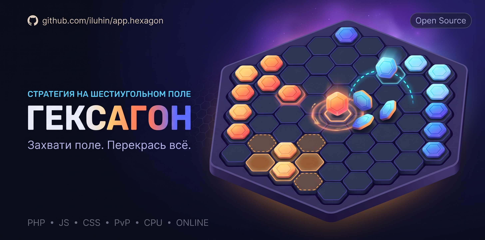
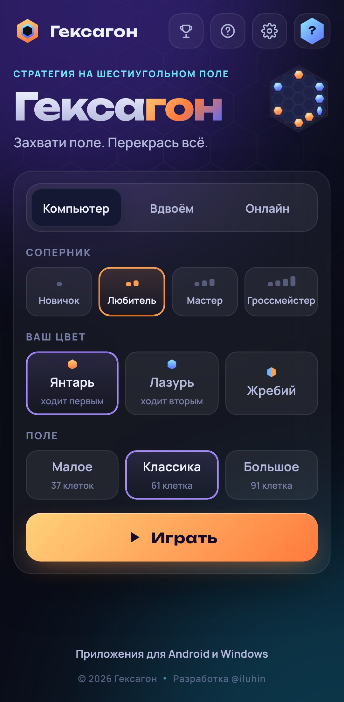
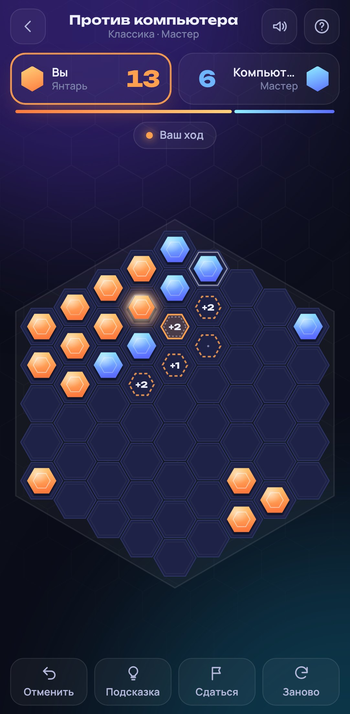
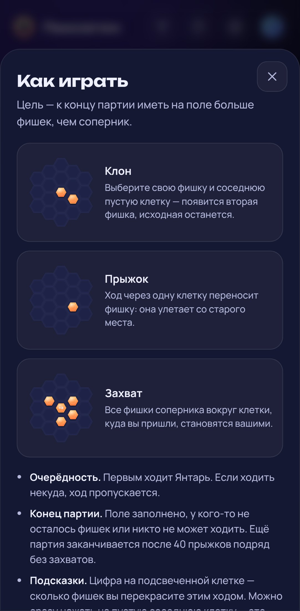
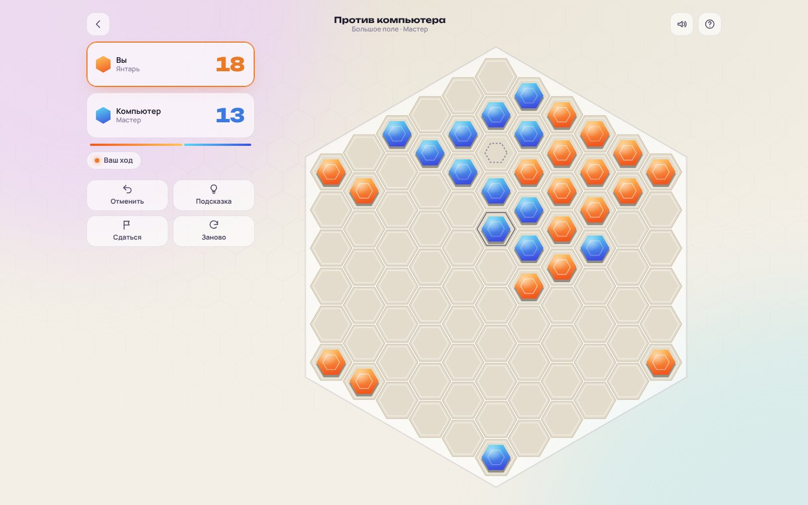

[Русский](README.md) · **English** · [Español](README.es.md) · [简体中文](README.zh-CN.md)

# Гексагон

**A strategy game on a hexagonal board.** Clone your pieces, jump over a cell,
and convert your opponent's pieces. Play against the computer, with a friend on one device, or online.

[**▶ Play in your browser**](https://hexagon.iluh.in/) ·
[**⬇ Android and Windows**](https://hexagon.iluh.in/download) ·
[**📖 Wiki**](../../wiki) ·
[**🗒 Releases**](../../releases)

---

## Rules in a minute

Select one of your pieces and an empty cell nearby:

| | Move | What happens |
|:-:|---|---|
| 🟠 → 🟠🟠 | **Clone** — to an adjacent cell | a second piece appears; the first stays in place |
| 🟠 ⤳ · 🟠 | **Jump** — over one cell | the piece jumps, leaving its old cell empty |
| 🔵🔵 → 🟠🟠 | **Capture** | all opposing pieces around the new cell become yours |

If you have no legal move, your turn is skipped. When no moves remain, the player
with the most pieces wins. See the [wiki](../../wiki/Rules) for details, pictures, and tips.

<table>
<tr>
<td width="33%"></td>
<td width="33%"></td>
<td width="33%"></td>
</tr>
</table>

## Game features

- 🤖 **Four computer difficulty levels** — from «Новичок» (“Beginner”), which makes mistakes on purpose, to
  «Гроссмейстер» (“Grandmaster”), which looks several moves ahead.
- 👥 **Two players on one screen** — pass the phone back and forth.
- 🌐 **Online play** — a quick game with a random opponent or your own table: send
  a friend a code or link. After the game, play a rematch with colors swapped.
- 🏆 **A chess-style rating.** It rises when you win online or against the computer.
  [How it is calculated](../../wiki/Rating).
- 💡 **Hints** — each cell shows how many pieces a move will gain. You can undo
  a move or ask the computer for advice (that game will be unrated).
- 🎨 **Dark and light themes**, sound, vibration, smooth animations — all can be
  turned off in settings.
- 📐 **Three boards**: a small 37-cell board for a quick game, a classic 61-cell board,
  and a large 91-cell board.

## Android app

- **Works offline.** The board, engine, and computer opponent are built into the app:
  a game against the computer or with a friend on one device starts instantly, even on a plane. Online play
  and ratings are the same as on the website, with a shared profile.
- **Easy updates.** If you installed from a file, the game will offer a new
  version and open it in your browser. If installed from a store, the store handles updates.
- **Nothing extra.** 0.4 MB, three permissions (internet, network state,
  vibration), no ads or trackers.
- **Invitations open in the game.** A friend's table link takes you straight to the table.

## Windows app

- **No installation.** One file: download, run, and play.
- **Its own window** in the game's style, sized to fit your screen; its position is remembered.
- **Offline play** — against the computer or with a friend on one device. Online play and ratings use the same
  profile as the website and phone app.
- **Built-in QR code** — «Игра на телефоне» (“Play on your phone”) at the bottom of the home screen.
- On first launch, Windows may display a SmartScreen window: the file is not yet
  signed with a certificate. «Подробнее» (“More info”) → «Выполнить в любом случае» (“Run anyway”).

## Where to play

| | |
|---|---|
| 🌐 **Browser** | [hexagon.iluh.in](https://hexagon.iluh.in/) — on your phone, tablet, or computer |
| 📱 **As an app** | Chrome: “⋮” menu → «Установить приложение» (“Install app”). iPhone: Safari → «Поделиться» (“Share”) → «На экран „Домой“» (“Add to Home Screen”) |
| 🤖 **Android** | [**Download APK**](https://hexagon.iluh.in/download) — 0.4 MB, Android 7.0+, works offline |
| 🪟 **Windows** | [**Download EXE**](https://hexagon.iluh.in/download) — 7 MB, Windows 10 and 11, no installation, works offline |
| 📦 **Files** | both are in the [latest release](../../releases/latest) |

Create a profile with a name and password; no email is needed. You can also play
as a guest, without a rating.

## What is in this repository

The game's page, [wiki](../../wiki), and [releases](../../releases) containing the apps.
The source code for the website and apps is kept separately.

## Questions and suggestions

- 🐞 [Report a bug](../../issues/new?template=bug.yml)
- 💡 [Suggest an idea](../../issues/new?template=idea.yml)
- 📖 [Frequently asked questions](../../wiki/FAQ)

---

© Илья Анисимов · [@iluhin](https://iluh.in)

