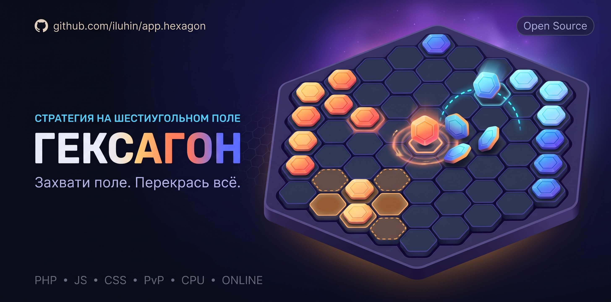
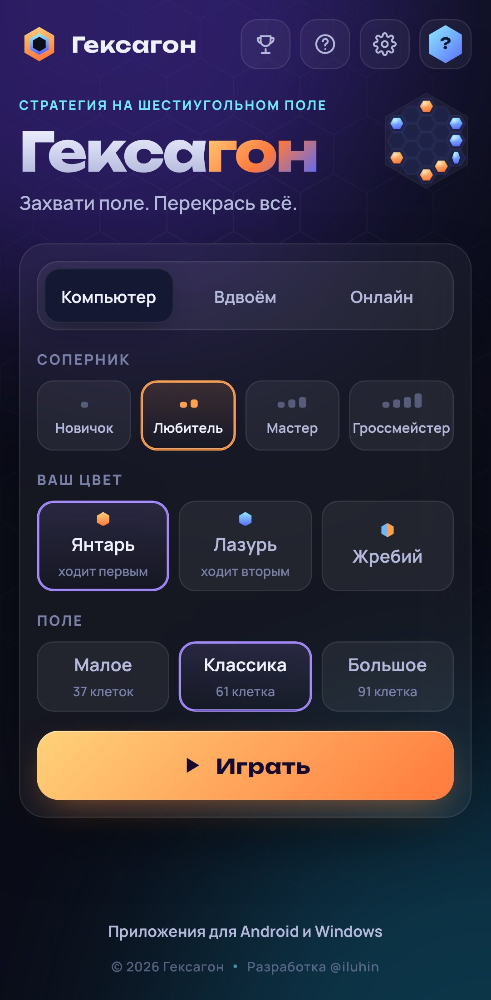
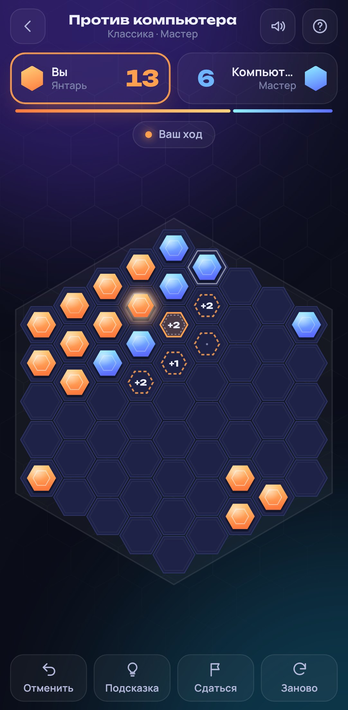
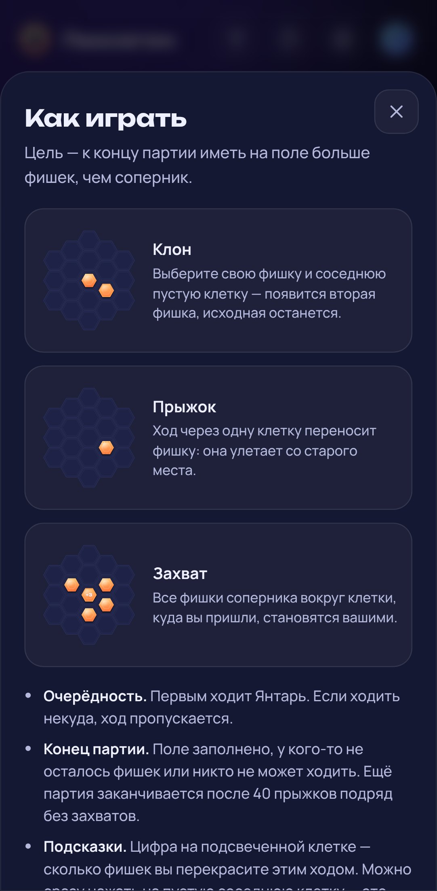
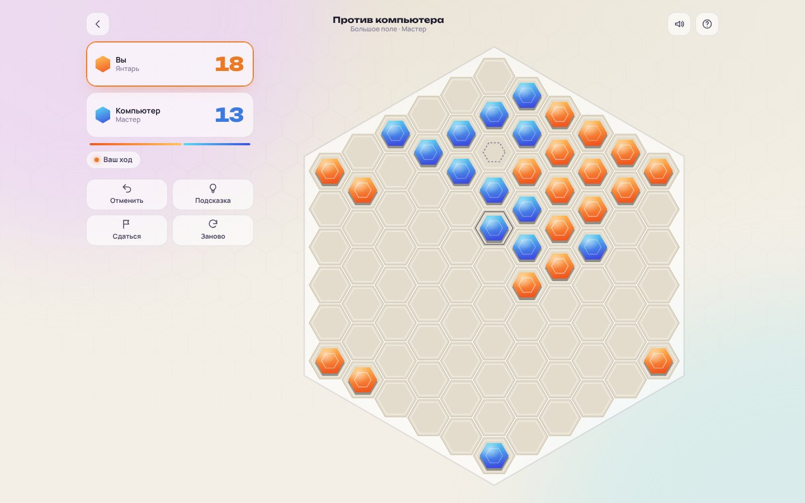

[Русский](README.md) · [English](README.en.md) · **Español** · [简体中文](README.zh-CN.md)

# Гексагон

**Un juego de estrategia en un tablero hexagonal.** Clona tus fichas, salta una casilla
y convierte las fichas del rival. Juega contra la computadora, con otra persona en el mismo dispositivo o en línea.

[**▶ Jugar en el navegador**](https://hexagon.iluh.in/) ·
[**⬇ Android y Windows**](https://hexagon.iluh.in/download) ·
[**📖 Wiki**](../../wiki) ·
[**🗒 Versiones**](../../releases)

---

## Las reglas en un minuto

Selecciona una de tus fichas y una casilla vacía cercana:

| | Movimiento | Qué ocurre |
|:-:|---|---|
| 🟠 → 🟠🟠 | **Clonación** — a una casilla adyacente | aparece una segunda ficha y la primera permanece en su sitio |
| 🟠 ⤳ · 🟠 | **Salto** — por encima de una casilla | la ficha salta y deja vacía su casilla anterior |
| 🔵🔵 → 🟠🟠 | **Captura** | todas las fichas del rival alrededor de la nueva casilla pasan a ser tuyas |

Si no tienes movimientos posibles, se salta tu turno. Cuando ya no quedan movimientos,
gana quien tenga más fichas. Encontrarás más detalles, imágenes y consejos en la [wiki](../../wiki/Rules).

<table>
<tr>
<td width="33%"></td>
<td width="33%"></td>
<td width="33%"></td>
</tr>
</table>

## Qué ofrece el juego

- 🤖 **Cuatro niveles de dificultad de la computadora** — desde «Новичок» («Principiante»), que comete errores a propósito, hasta
  «Гроссмейстер» («Gran maestro»), que calcula varios movimientos por adelantado.
- 👥 **Dos personas en una misma pantalla** — pasen el teléfono de una a otra.
- 🌐 **Juego en línea** — una partida rápida con un rival al azar o tu propia mesa: envía
  un código o enlace a un amigo. Después de la partida, pueden jugar la revancha intercambiando los colores.
- 🏆 **Puntuación como en el ajedrez.** Sube al ganar en línea o contra la computadora.
  [Cómo se calcula](../../wiki/Rating).
- 💡 **Pistas** — cada casilla muestra cuántas fichas dará el movimiento. Puedes deshacer
  una jugada o pedir consejo a la computadora (esa partida no contará para la puntuación).
- 🎨 **Temas oscuro y claro**, sonido, vibración y animaciones fluidas: todo se puede
  desactivar en los ajustes.
- 📐 **Tres tableros**: uno pequeño de 37 casillas para una partida rápida, el clásico de 61
  y uno grande de 91.

## Aplicación para Android

- **Funciona sin internet.** El tablero, el motor y el rival informático están integrados en la aplicación:
  una partida contra la computadora o con otra persona en el mismo dispositivo empieza al instante, incluso en un avión. El juego en línea
  y la puntuación son los mismos que en la web, con un perfil compartido.
- **Actualizaciones sencillas.** Si la instalaste desde un archivo, el juego te ofrecerá la nueva
  versión y la abrirá en el navegador. Si la instalaste desde una tienda, la tienda se encarga de actualizarla.
- **Nada de más.** 0,4 MB, tres permisos (internet, estado de la red
  y vibración), sin anuncios ni rastreadores.
- **Las invitaciones se abren en el juego.** El enlace de un amigo a una mesa te lleva directamente a ella.

## Programa para Windows

- **Sin instalación.** Un solo archivo: lo descargas, lo ejecutas y juegas.
- **Ventana propia** con el estilo del juego, adaptada al tamaño de tu pantalla; recuerda su posición.
- **Sin internet** — contra la computadora o con otra persona en el mismo dispositivo. El juego en línea y la puntuación usan el mismo
  perfil que la web y la aplicación del teléfono.
- **QR integrado** — «Игра на телефоне» («Jugar en el teléfono») en la parte inferior de la pantalla principal.
- Al ejecutarlo por primera vez, Windows puede mostrar una ventana de SmartScreen: el archivo aún no está
  firmado con un certificado. «Подробнее» («Más información») → «Выполнить в любом случае» («Ejecutar de todas formas»).

## Dónde jugar

| | |
|---|---|
| 🌐 **Navegador** | [hexagon.iluh.in](https://hexagon.iluh.in/) — en el teléfono, la tableta o la computadora |
| 📱 **Como aplicación** | Chrome: menú «⋮» → «Установить приложение» («Instalar aplicación»). iPhone: Safari → «Поделиться» («Compartir») → «На экран „Домой“» («Añadir a pantalla de inicio») |
| 🤖 **Android** | [**Descargar APK**](https://hexagon.iluh.in/download) — 0,4 MB, Android 7.0+, funciona sin conexión |
| 🪟 **Windows** | [**Descargar EXE**](https://hexagon.iluh.in/download) — 7 MB, Windows 10 y 11, sin instalación, funciona sin conexión |
| 📦 **Archivos** | ambos están en la [última versión](../../releases/latest) |

El perfil se crea con un nombre y una contraseña, sin correo electrónico. También puedes jugar
como invitado, sin puntuación.

## Qué contiene este repositorio

La página del juego, la [wiki](../../wiki) y las [versiones](../../releases) con las aplicaciones.
El código fuente de la web y de las aplicaciones se guarda por separado.

## Preguntas y sugerencias

- 🐞 [Informar de un error](../../issues/new?template=bug.yml)
- 💡 [Proponer una idea](../../issues/new?template=idea.yml)
- 📖 [Preguntas frecuentes](../../wiki/FAQ)

---

© Илья Анисимов · [@iluhin](https://iluh.in)

