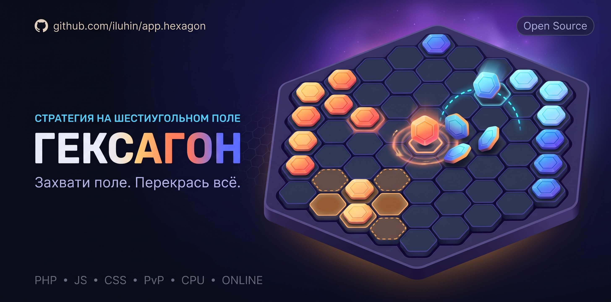
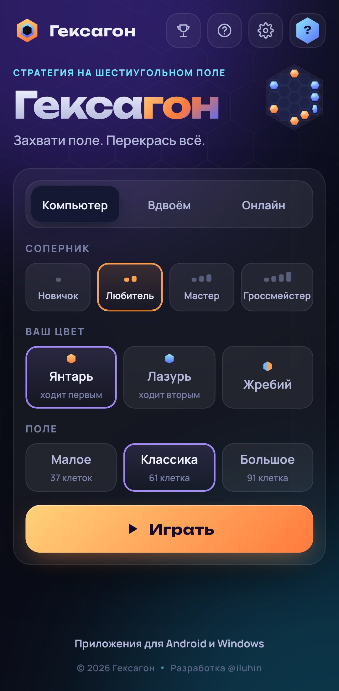
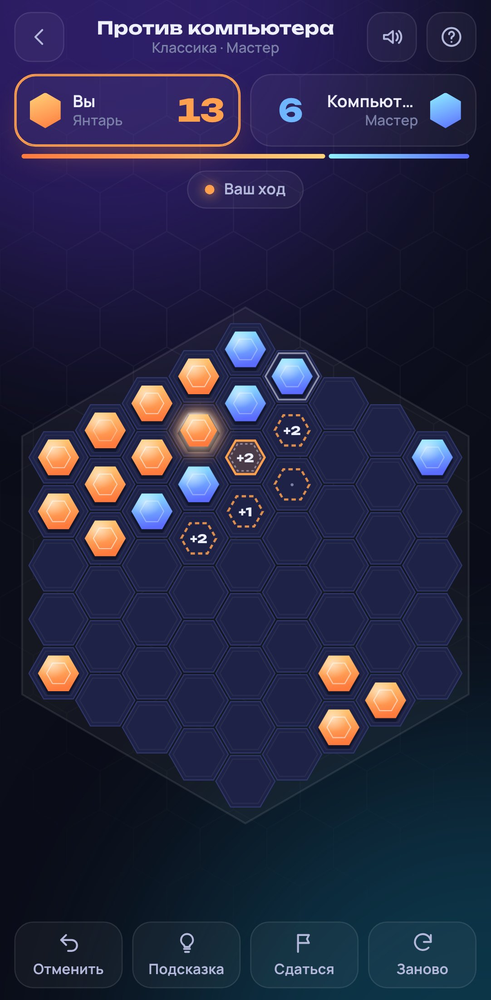
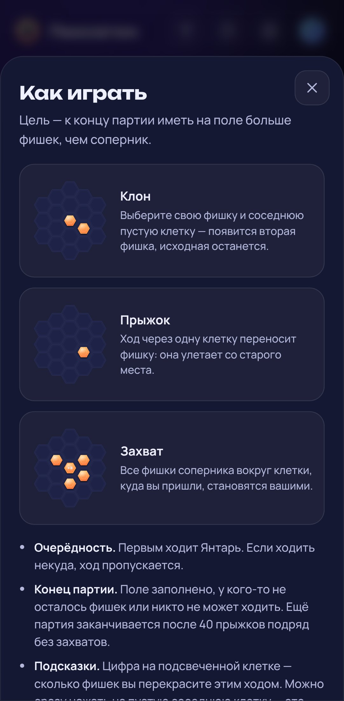
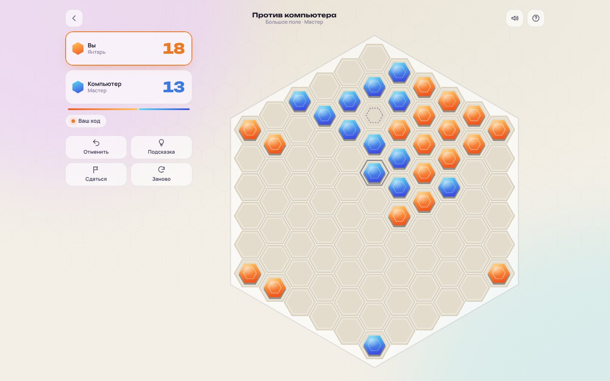

# Гексагон

**Стратегия на шестиугольном поле.** Клонируй фишки, прыгай через клетку
и перекрашивай соперника. Против компьютера, вдвоём или онлайн.

[**▶ Играть в браузере**](https://hexagon.iluh.in/) ·
[**📖 Вики**](../../wiki) ·
[**🗒 Выпуски**](../../releases)

---

## Правила за минуту

Выберите свою фишку и пустую клетку рядом:

| | Ход | Что происходит |
|:-:|---|---|
| 🟠 → 🟠🟠 | **Клон** — на соседнюю клетку | появляется вторая фишка, первая остаётся |
| 🟠 ⤳ · 🟠 | **Прыжок** — через одну клетку | фишка перелетает, старая клетка пустеет |
| 🔵🔵 → 🟠🟠 | **Захват** | все фишки соперника вокруг новой клетки становятся вашими |

Нечем ходить — ход пропускается. Когда ходов больше нет, побеждает тот, у кого
больше фишек. Подробнее, с картинками и советами, — в [вики](../../wiki/Rules).

<table>
<tr>
<td width="33%"></td>
<td width="33%"></td>
<td width="33%"></td>
</tr>
</table>

## Что есть в игре

- 🤖 **Компьютер четырёх уровней** — от Новичка, который нарочно ошибается, до
  Гроссмейстера, который просчитывает на несколько ходов вперёд.
- 👥 **Вдвоём за одним экраном** — передавайте телефон друг другу.
- 🌐 **Онлайн** — быстрая игра со случайным соперником или свой стол: отправьте
  другу код или ссылку. После партии — реванш со сменой цветов.
- 🏆 **Рейтинг** как в шахматах. Растёт за победы онлайн и над компьютером.
  [Как он считается](../../wiki/Rating).
- 💡 **Подсказки** — на клетке видно, сколько фишек даст ход. Можно отменить
  ход или спросить совет у компьютера (такая партия идёт без рейтинга).
- 🎨 **Тёмная и светлая темы**, звук, вибрация, плавные анимации — всё
  отключается в настройках.
- 📐 **Три поля**: малое на 37 клеток для быстрой партии, классика на 61 и
  большое на 91.

## Где играть

| | |
|---|---|
| 🌐 **Браузер** | [hexagon.iluh.in](https://hexagon.iluh.in/) — на телефоне, планшете и компьютере |
| 📱 **Как приложение** | Chrome: меню «⋮» → «Установить приложение». iPhone: Safari → «Поделиться» → «На экран „Домой“» |
| 🤖 **Android** | APK готовится — появится на [странице выпусков](../../releases) |
| 🪟 **Windows** | EXE готовится — появится на [странице выпусков](../../releases) |

Профиль заводится по имени и паролю, без почты. Играть гостем тоже можно —
просто без рейтинга.

## Что в этом репозитории

Страница игры, [вики](../../wiki) и [выпуски](../../releases) с приложениями.
Исходный код сайта и приложений хранится отдельно.

## Вопросы и пожелания

- 🐞 [Сообщить об ошибке](../../issues/new?template=bug.yml)
- 💡 [Предложить идею](../../issues/new?template=idea.yml)
- 📖 [Частые вопросы](../../wiki/FAQ)

---

© Илья Анисимов · [@iluhin](https://iluh.in)

