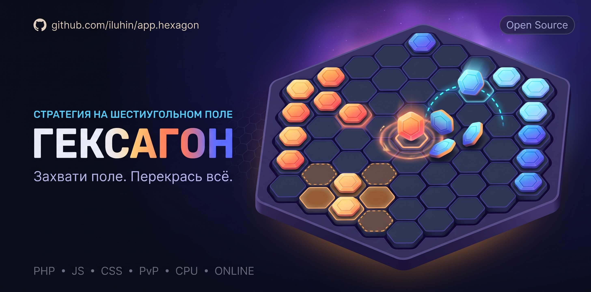
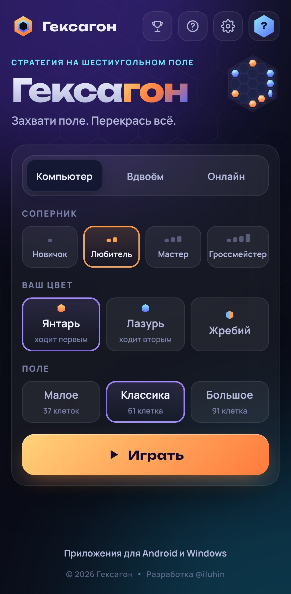
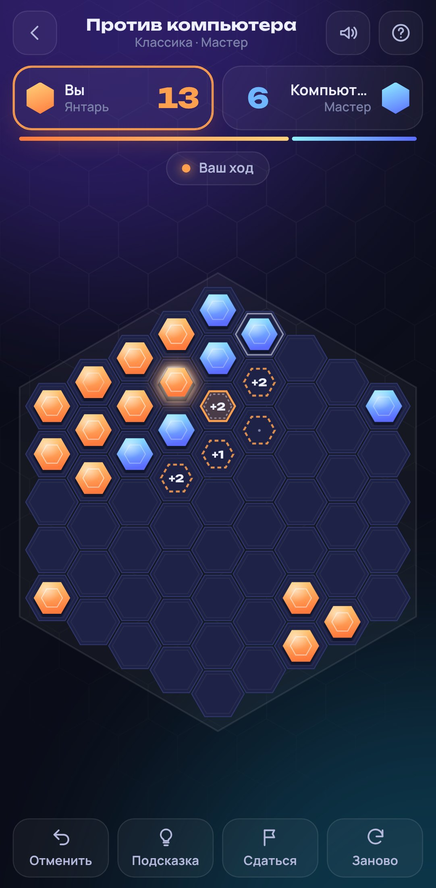
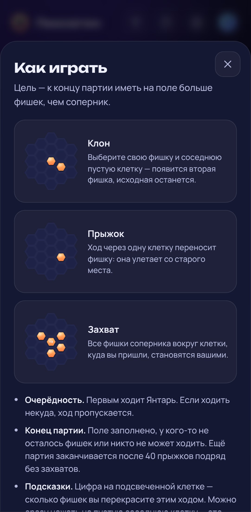
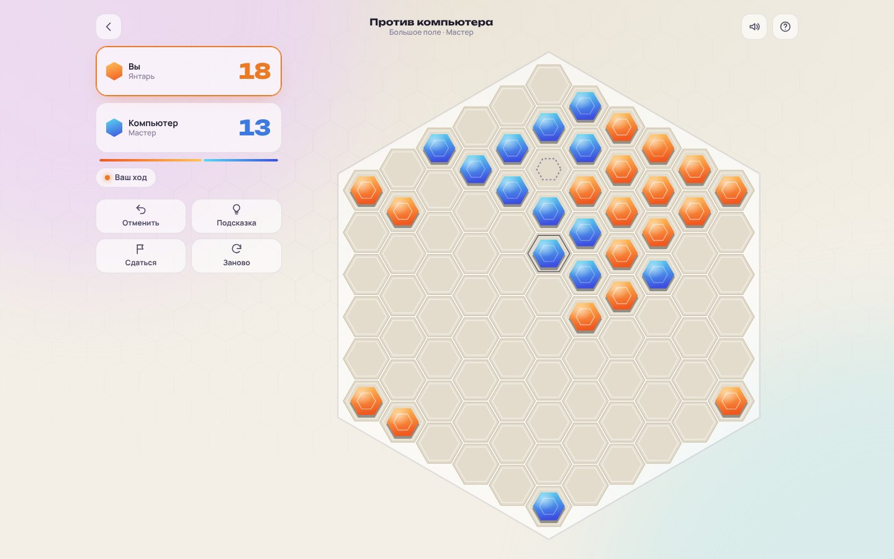

[Русский](README.md) · [English](README.en.md) · [Español](README.es.md) · **简体中文**

# Гексагон

**六边形棋盘上的策略游戏。** 复制棋子，隔一格跳跃，
将对手的棋子变为己方颜色。可以与电脑对弈、同机双人对战或在线对战。

[**▶ 在浏览器中游玩**](https://hexagon.iluh.in/) ·
[**⬇ Android 和 Windows**](https://hexagon.iluh.in/download) ·
[**📖 Wiki**](../../wiki) ·
[**🗒 发行版本**](../../releases)

---

## 一分钟了解规则

选择一枚己方棋子，再选择附近的一个空格：

| | 走法 | 效果 |
|:-:|---|---|
| 🟠 → 🟠🟠 | **复制** — 移至相邻格 | 生成第二枚棋子，原棋子保留 |
| 🟠 ⤳ · 🟠 | **跳跃** — 隔一格跳跃 | 棋子跳至目标格，原格变空 |
| 🔵🔵 → 🟠🟠 | **占领** | 目标格周围的所有对方棋子都变为己方棋子 |

没有可走的棋时，跳过本回合。当双方都无法继续走棋时，
棋子较多的一方获胜。更多说明、图片和技巧请参阅 [Wiki](../../wiki/Rules)。

<table>
<tr>
<td width="33%"></td>
<td width="33%"></td>
<td width="33%"></td>
</tr>
</table>

## 游戏功能

- 🤖 **四档电脑难度** — 从会故意犯错的「Новичок」（新手），到
  能提前计算数步的「Гроссмейстер」（特级大师）。
- 👥 **同屏双人对战** — 轮流传递手机即可。
- 🌐 **在线对战** — 快速匹配随机对手，或创建自己的棋桌：将代码或链接
  发给好友。一局结束后，可以交换颜色再战。
- 🏆 **类似国际象棋的等级分。** 在线对战或战胜电脑均可提升等级分。
  [计算方式](../../wiki/Rating)。
- 💡 **提示** — 棋盘格会显示这一手能获得多少枚棋子。可以悔棋，
  也可以向电脑请教（该局将不计等级分）。
- 🎨 **深色和浅色主题**、声音、振动、流畅动画 — 均可在设置中
  关闭。
- 📐 **三种棋盘**：适合快速对局的 37 格小棋盘、61 格经典棋盘，
  以及 91 格大棋盘。

## Android 应用

- **无需联网即可游玩。** 棋盘、游戏引擎和电脑对手均内置于应用中：
  即使在飞机上，也能立即开始与电脑对弈或同机双人对战。在线对战
  和等级分与网站相同，共用同一账户资料。
- **更新简单。** 如果通过安装文件安装，游戏会提示新
  版本，并在浏览器中打开。如果从应用商店安装，则由商店负责更新。
- **没有多余内容。** 0.4 MB，仅需三项权限（联网、查看网络状态、
  振动），无广告，无跟踪器。
- **邀请链接直接在游戏中打开。** 好友发来的棋桌链接会直接带你进入棋桌。

## Windows 程序

- **免安装。** 只有一个文件：下载、运行，即可游玩。
- **独立窗口**，采用游戏风格，大小适配屏幕，并记住窗口位置。
- **离线游玩** — 支持与电脑对弈和同机双人对战。在线对战与等级分使用的
  账户资料与网站和手机端相同。
- **内置二维码** — 主界面底部的「Игра на телефоне」（在手机上游玩）。
- 首次运行时，Windows 可能会显示 SmartScreen 窗口：该文件尚未
  使用证书签名。点击「Подробнее」（更多信息）→「Выполнить в любом случае」（仍要运行）。

## 在哪里玩

| | |
|---|---|
| 🌐 **浏览器** | [hexagon.iluh.in](https://hexagon.iluh.in/) — 支持手机、平板电脑和电脑 |
| 📱 **作为应用使用** | Chrome：「⋮」菜单 →「Установить приложение」（安装应用）。iPhone：Safari →「Поделиться」（分享）→「На экран „Домой“」（添加到主屏幕） |
| 🤖 **Android** | [**下载 APK**](https://hexagon.iluh.in/download) — 0.4 MB，Android 7.0+，支持离线游玩 |
| 🪟 **Windows** | [**下载 EXE**](https://hexagon.iluh.in/download) — 7 MB，Windows 10 和 11，免安装，支持离线游玩 |
| 📦 **文件** | 两种文件均可在[最新版本](../../releases/latest)中找到 |

使用名称和密码即可创建账户，无需电子邮箱。也可以以游客身份游玩，
但不计等级分。

## 本仓库包含什么

游戏介绍页面、[Wiki](../../wiki) 以及包含应用文件的[发行版本](../../releases)。
网站和应用的源代码另行存放。

## 问题与建议

- 🐞 [报告错误](../../issues/new?template=bug.yml)
- 💡 [提出想法](../../issues/new?template=idea.yml)
- 📖 [常见问题](../../wiki/FAQ)

---

© Илья Анисимов · [@iluhin](https://iluh.in)

